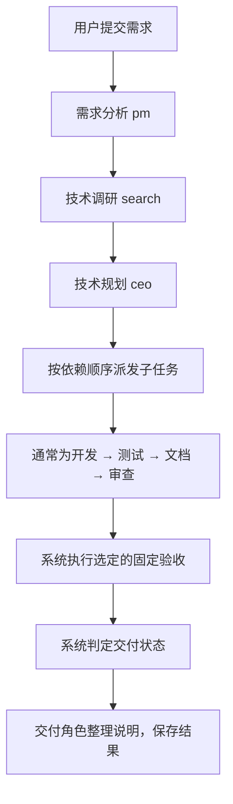

# 重构后项目说明

本文用于熟悉重构后的 Lewis。现场操作见 [答辩演示流程](答辩演示流程.md)，测试记录见 [测试报告](test-report-20261020.md)。

## 1. 项目现在做什么

Lewis 现在面向软件开发场景：用户提交需求，系统组织不同角色分析、规划、编写代码、执行测试、编写文档和审查，最后提供文件与验证结果。

Lewis 本身是开发协作平台。短信分类、CSV 批量预测是它生成的示例项目，用来验证交付流程。示例虽然小，但会经过真实模型调用、文件写入和测试执行。

重构沿用原有 FastAPI、LangGraph、MCP、SQLite 和 Vue 架构，重点是收敛业务范围、补齐真实执行与交付判断。

| 方面 | 当前做法 |
|---|---|
| 业务定位 | 从泛化的智能体公司收敛为软件开发协作团队 |
| 执行方式 | 按计划和依赖顺序执行，保存各阶段结果 |
| 代码产物 | 写入每个任务自己的目录，可查看和下载 |
| 质量判断 | 结合真实测试、代码审查、证据有效性和选定的固定验收 |
| 后续开发 | 从已有任务复制基线，在新任务中修改并记录父子关系 |
| 过程回看 | 保存任务、事件、工具调用和结果，支持历史查看与刷新恢复 |

## 2. 一条需求如何执行

模型负责理解、规划和生成内容；LangGraph 组织流程；MCP 工具负责实际文件操作、测试命令等执行；后端根据证据判定交付。

子任务按计划顺序执行，并检查依赖。前置任务失败时，依赖它的任务可能被跳过。办公室动画展示角色分工和状态，实际顺序以任务流程与子任务记录为准。

| 角色标识 | 当前职责 |
|---|---|
| pm | 整理需求、范围和验收条件 |
| search | 调用 Serper 搜索，整理技术来源 |
| ceo | 作为技术负责人制定任务、顺序和依赖 |
| dev | 读取或编写实际代码，记录任务内 Git 变更 |
| test | 读取代码、生成测试，通过工具执行 pytest 并读取结果 |
| writer | 编写 README，说明使用方法与限制 |
| review | 阅读实际文件，提出代码问题和风险 |
| customer | 根据系统给出的状态和证据整理交付说明 |

devops、analyst 等角色仍保留支持，最小示例通常不需要执行。内部角色标识沿用原项目名称。

## 3. 打开页面后看什么

前端有“开发工作台”和“任务历史”两个入口。输入框下方的流程、交付、证据和日志默认折叠在“任务详情”中，办公室紧随其后；查看报告或文件时先展开。

| 页面区域 | 用途 |
|---|---|
| 需求输入 | 输入开发需求，也可填入最小演示需求、选择固定验收 |
| 任务流程 | 查看当前阶段、子任务顺序、执行与跳过情况 |
| 办公室视图 | 直观展示角色职责与工作状态 |
| 交付结果 | 查看最终状态和交付说明 |
| 交付证据 | 查看真实测试、固定验收、工具调用、文件及增量变更 |
| 执行日志 | 查看执行事件和错误，辅助解释过程 |
| 任务历史 | 按状态查找任务，重新打开过程与交付结果 |

任务地址包含 `#task=任务编号`，刷新后可重新加载该任务。连接中断时，页面通过保存的事件补取进度；历史中缺少测试证据的记录不会被当作已经测试通过。

调研入口更新：在“需求、计划与交付证据”顶部点击“查看调研报告”，可在新标签页阅读；点击“下载报告 .md”可保存文档。报告由任务已保存的调研内容整理，包括关键词、结论、建议、来源和技术方案采纳情况。已有案例同样支持，无需重新调用模型。需求、调研、计划和审查通过分区按钮切换，MCP 明细默认收起。

## 4. 怎么判断任务真的完成了

| 状态 | 含义 |
|---|---|
| queued | 已接收，等待执行 |
| running | 正在执行 |
| completed | 当前交付通过系统要求的完成检查 |
| partial | 有产出，但仍有未完成或不符合要求的环节 |
| failed | 执行失败，无法作为完整交付 |

需要区分三种结果：

- **角色测试**：test 角色编写测试，再通过工具真正运行。页面展示实际命令、输出和结果。
- **固定验收**：系统使用仓库预设的业务测试检查接口契约，独立于本次模型生成的测试。仅在选择相应验收方案时执行。
- **代码审查**：review 角色阅读文件后提出问题，属于质量意见，不能代替实际测试。

系统会检查真实测试是否通过、是否存在阻断问题、验证证据是否对应当前文件，以及选定的固定验收是否通过。后续代码变化会使旧验证证据失效，需要重新验证。交付角色不能凭一句“完成”提高系统判定的状态。

例如：代码测试通过，但文档生成失败，仍可能是“部分完成”。测试数量多，也不能直接说明比固定业务验收更可靠，应查看测试覆盖了什么。

## 5. 短信案例与增量开发

正式案例是 FastAPI + 原生网页，复用已有 Transformer 对英文短信做真实分类，展示类别、概率、历史实验对比与数据划分。Lewis 开发应用、测试和文档；模型权重与预处理不是本次训练产生。

基础接口：GET /、POST /predict、GET /metrics。增量 POST /predict-batch 接收 text 列 CSV（1—100 行），网页展示结果并下载 CSV，处理逗号、引号、换行和公式前缀；错误清除旧结果。

最终编号见 demo/sms-classifier/case.json；基础固定验收 5 项，CSV 合计 8 项，角色测试以实际报告为准。统一入口 start_demo.py 在一个终端启动工作台及两个生成应用，Ctrl+C 统一停止。底层独立入口仍保留供调试使用。

增量任务复制父文件，在新目录读取和修改，保存父子关系与变更；原基础文件不变。答辩按总流程先介绍 Lewis，再展示基础示例与证据，然后使用办公室“演示协作全流程”，最后展示增量证据及CSV成果：32 秒纯前端预设动画，状态独立，不调用 API、不创建任务、不改变产物；阶段提示和连接线帮助讲解。支持停止、退出和重播，真实任务运行时禁用。它不是历史事件回放。真正开发仍用“提交开发需求”。
## 6. 数据和文件保存在哪里

| 内容 | 保存方式与作用 |
|---|---|
| 任务需求、状态、阶段结果 | SQLite 保存，支持历史回看 |
| 执行事件 | SQLite 的事件记录，支持按事件编号补取 |
| 实时通知 | WebSocket 推送；Redis 可选，用于通知，不承担唯一持久化 |
| 生成代码与文档 | `backend/workspace/tasks/任务编号/` |
| 真实测试与固定验收报告 | 任务目录下 `.lewis/`，包括 XML、JSON 等报告 |
| 任务版本记录 | 任务目录内的独立 Git 仓库 |
| 当前演示入口的历史库 | `backend/workspace/validation/sms-history.db` |

Lewis 源码仓库的 Git 与生成任务自己的 Git 分别记录平台代码和产物代码。任务文件与数据库需要配套保留；只复制源码，不能恢复本地已有案例。

模型与搜索配置从仓库根目录 `.env` 读取。历史库路径由实际启动入口决定，不能仅修改 `DATABASE_URL` 就假定所有 SQLite 存储随之切换。

## 7. 关键代码地图

| 位置 | 阅读目的 |
|---|---|
| `backend/main.py` | 任务提交、历史、文件、日志与 WebSocket 接口 |
| `backend/graph/company_graph.py` | 主流程、子任务派发、阶段保存与交付 |
| `backend/graph/contracts.py` | 计划依赖校验和交付状态规则 |
| `backend/graph/evidence.py` | 核对文件哈希，判断测试等证据是否失效 |
| `backend/graph/context.py` | 为不同阶段裁剪上下文，减少重复内容 |
| `backend/agents/` | 各角色的提示、模型调用与结果处理 |
| `backend/agents/base.py` | 通用模型接入、超时和格式处理 |
| `backend/agents/scope.py` | 最小案例各角色的范围约束 |
| `backend/lewis_mcp/` | 文件、Git、Shell、搜索等工具及角色权限 |
| `backend/revisions.py` | 父任务基线复制、增量变更与任务关联 |
| `backend/memory/sqlite_history.py` | 任务和事件持久化 |
| `start_demo.py` | 单终端启动与统一停止演示服务 |
| `frontend/src/collaborationDemo.js` | 32 秒预设演示阶段与时长 |
| `backend/view_demo.py` | 启动包含真实案例的现有系统 |
| `frontend/src/App.vue` | 工作台与历史入口 |
| `frontend/src/components/` | 输入、流程、结果、证据与历史组件 |
| `frontend/src/stores/` | 前端任务状态、事件和恢复处理 |
| `frontend/src/smsDemo.js` | 短信基础与 CSV 增量的预设需求 |
| `demo/sms-classifier/` | 最小案例的固定业务契约与验收资源 |

主要接口是 `POST /api/task`，提交 `user_input`，可选 `acceptance_profile` 和 `parent_task_id`。前端通过 `GET /api/tasks` 查历史，通过 `/api/task/{id}` 及其日志、产物、父子关联接口查看记录，通过 `/ws/{id}` 接收实时事件。

建议阅读顺序：先用页面查看成功案例，再读主流程和交付规则，最后按需读具体角色与工具实现。

## 8. 配置、启动与当前边界

启动命令见 [项目首页](../README.md)，模型接入见 [模型配置](model-config.md)。短信演示使用 `backend/venv-sms` 和系统 Edge。

模型主要配置为 `LLM_BASE_URL`、`LLM_API_KEY`、`LLM_MODEL`；搜索使用 `SERPER_API_KEY`。支持 OpenAI 兼容的 Chat Completions 接口，换平台时应核对地址、模型名和格式支持。不同模型的生成质量、速度与成功率仍需实际验证。

本项目适合答辩说明的特点是：角色按依赖组织实际开发；真实文件、测试、审查和固定验收共同支撑交付；任务可追溯，也能在保留父任务的前提下继续开发。这些属于工程实现特点，不宣称提出了新的模型算法。

当前按单进程运行，中断后会记录失败，尚无自动断点续跑。角色权限与任务目录隔离也不等于操作系统沙箱。过程记录可以帮助核对产物来源，但不构成防篡改证明。

最新验证见 demo/sms-classifier/verification.md；结果仅证明已覆盖范围，不保证所有需求或模型稳定完成。

